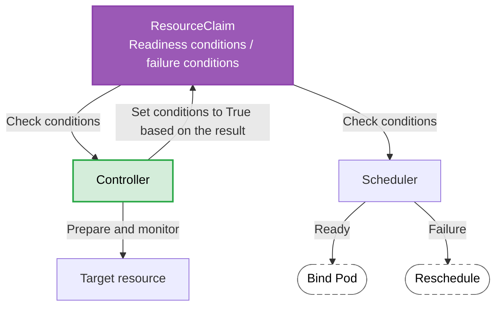
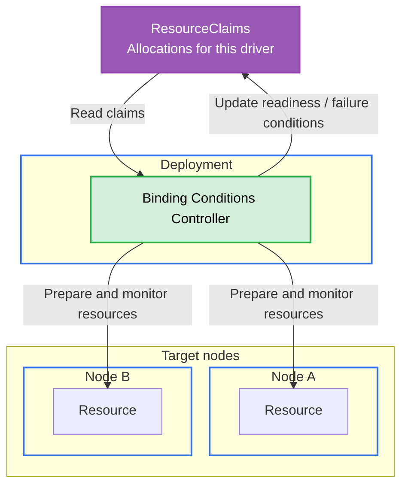
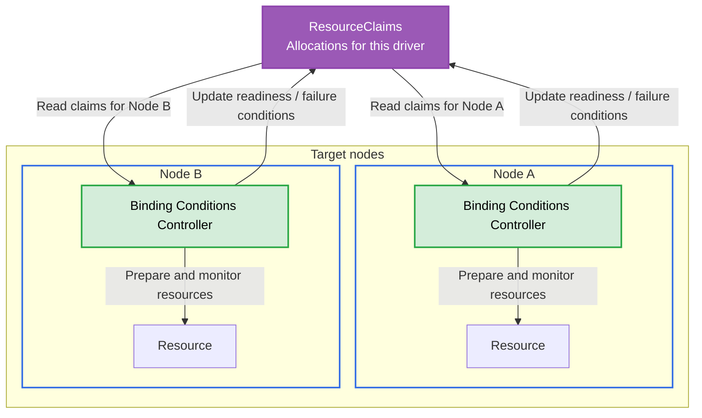

# Device Binding Conditions Developer Guide

This guide is for DRA driver developers who want to use Device Binding Conditions.
It introduces concepts and approaches that can help when designing and implementing
a driver that uses this feature.

For details on how the feature works, see the Kubernetes
[Device Binding Conditions documentation](https://kubernetes.io/docs/concepts/resource-management/dynamic-resource-allocation/how-dra-works/#device-binding-conditions).
To run this example, see the [example README](README.md).

## Contents

- [How Device Binding Conditions Work](#how-device-binding-conditions-work)
- [Controller design](#controller-design)
  - [Centralized controllers](#centralized-controllers)
  - [Distributed per-node controllers](#distributed-per-node-controllers)
    - [Finding ResourceClaims using a Pod's nominatedNodeName](#finding-resourceclaims-using-a-pods-nominatednodename)
  - [This example uses a centralized controller](#this-example-uses-a-centralized-controller)

## How Device Binding Conditions Work

Device Binding Conditions allow the scheduler to wait to bind a Pod until its
resources are ready.

A controller checks the conditions on a ResourceClaim and prepares and monitors
the corresponding resources. It reports the result by setting readiness
conditions (Binding Conditions) or failure conditions (Binding Failure
Conditions). The scheduler uses these conditions to decide whether to proceed
with binding or reschedule the Pod.

Binding proceeds when no failure condition is true and all required readiness
conditions are `True`. If any failure condition is `True`, the Pod is
rescheduled with resources reallocated. Otherwise, the scheduler waits.

## Controller design

As described in the previous section, the controller prepares and monitors
resources, then updates the ResourceClaim conditions with the results.

The controller can run centrally or on each node. The following comparison
assumes that the target resources are located on individual nodes.

When running a controller on each node, an existing kubelet plugin can take on
this role instead of introducing a separate component. However, it must run
independently of `NodePrepareResources`, which is called after binding.

### Centralized controllers

In a centralized design, one or a few controller Pods run in a Deployment.
These Pods process ResourceClaims for their driver across all nodes.

The controller prepares and monitors resources, then updates the readiness or
failure conditions for each claim.

- **Benefit:** Fewer controller Pods need to be started and managed.
- **Trade-off:** If many claims need processing at once, work may queue at the
  central controller.

Developer discussions have suggested that, depending on the workload, a single
controller might process hundreds or thousands of claims per second. This is
an estimate, not a benchmark result or performance guarantee. Actual
performance depends on the work required for each claim and the capacity of
the Kubernetes API and external services.

### Distributed per-node controllers

In a distributed design, each node runs a controller and processes only claims
assigned to that node. The controllers can run as a DaemonSet or as part of the
driver's existing kubelet plugin. Each controller prepares and monitors
resources on its node, then updates readiness or failure conditions for the
claims it handles.

- **Benefit:** Each node can prepare resources independently, without routing
  all work through one controller.
- **Trade-off:** A controller must run on every target node, and the driver
  must determine which claims each controller handles.

This approach can help avoid a central controller becoming a bottleneck when
many nodes need their Binding Conditions updated at the same time.

#### Finding ResourceClaims using a Pod's nominatedNodeName

In a distributed design, each node's controller needs to find the
ResourceClaims associated with its node. If every controller watches or
examines all ResourceClaims in the cluster, the load increases as the number
of nodes and claims grows.

ResourceClaims currently do not support a field selector for the node to which
they are allocated. To narrow down what it watches and examines, a controller
can **watch Pods nominated for its node and retrieve the claims referenced by
those Pods**:

1. Set `fieldSelector: status.nominatedNodeName=<node-name>` on the Pod
   informer's List/Watch requests.
2. Read the claim references from each Pod and GET the ResourceClaims in the
   same namespace as the Pod. References to directly specified claims are in
   `spec.resourceClaims`; the names of claims generated from templates are in
   `status.resourceClaimStatuses`.
3. Check which claims are allocated to this driver, perform the required
   preparation, and update the Binding Conditions.

Before entering the PreBind phase, the scheduler sets
[`status.nominatedNodeName`](https://kubernetes.io/docs/concepts/scheduling-eviction/assign-pod-node/#nominatednodename)
for Pods that require PreBind. This lets the controller find claims before
Pod binding without waiting for `spec.nodeName` to be set. This behavior
requires `NominatedNodeNameForExpectation`, which is enabled by default
starting in Kubernetes 1.35.

This method filters Pods by node, not by whether they use Binding Conditions.
The controller still needs to check the retrieved claims.

### This example uses a centralized controller

The [controller Deployment](../../../deployments/helm/dra-example-driver/templates/controller-deployment.yaml)
runs a single Pod. It watches ResourceClaims across the cluster and processes
allocations for its driver.

The [BindingConditions plugin](../../../cmd/dra-example-controller/plugins/bindingconditions.go)
only marks allocated resources as ready; it does not prepare the resources
themselves. Since this is a simple status update that does not require
node-local processing, the example uses a centralized controller to keep the
implementation and configuration simple. A real driver should report
readiness only after confirming that preparation is complete.
