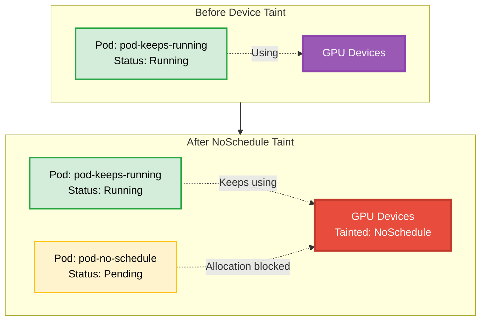

# Device Taint Pod NoSchedule Example

## Overview

`NoSchedule` prevents new allocations of devices with an untolerated taint.
Pods already using those devices keep running.

**Setup**: Create one pod requesting a GPU without tolerations, apply a `NoSchedule` device taint, then create a second pod.

## Device Taint Behavior



## Requirements

### Driver Requirements

- **Profile**: gpu
- **GPUs**: 2+

### Cluster Requirements

- **Kubernetes Version**: 1.37+
- **API Version**: `resource.k8s.io/v1`

For more information about device taints and tolerations, see the [Kubernetes documentation](https://kubernetes.io/docs/concepts/resource-management/dynamic-resource-allocation/device-taints/).

## How to Run

Run this example on its own, from this directory.

1. Create the ResourceClaimTemplate and first pod, then wait for the pod to be ready:

   Waiting ensures the first pod is already running when the taint is applied,
   so you can observe that `NoSchedule` does not evict it.

   ```bash
   kubectl apply -f 1-basic-resourceclaimtemplate.yaml
   kubectl apply -f 2-pod-keeps-running.yaml
   kubectl wait -n basic-resourceclaimtemplate \
     --for=condition=Ready pod/pod-keeps-running --timeout=120s
   ```

2. Apply the rule, which taints all devices managed by `gpu.example.com`, then create the second pod:

   ```bash
   kubectl apply -f 3-device-taint-rule.yaml
   kubectl apply -f 4-pod-not-scheduled.yaml
   ```

3. Observe the pods and scheduling events:

   ```bash
   kubectl get pods -n basic-resourceclaimtemplate
   kubectl get events -n basic-resourceclaimtemplate
   ```

## Expected Behavior

- `pod-keeps-running` stays Running because `NoSchedule` does not evict pods.
- `pod-no-schedule` stays Pending because it has no toleration for the device taint.

## Cleanup

```bash
kubectl delete -f 4-pod-not-scheduled.yaml
kubectl delete -f 3-device-taint-rule.yaml
kubectl delete -f 2-pod-keeps-running.yaml
kubectl delete -f 1-basic-resourceclaimtemplate.yaml
```
